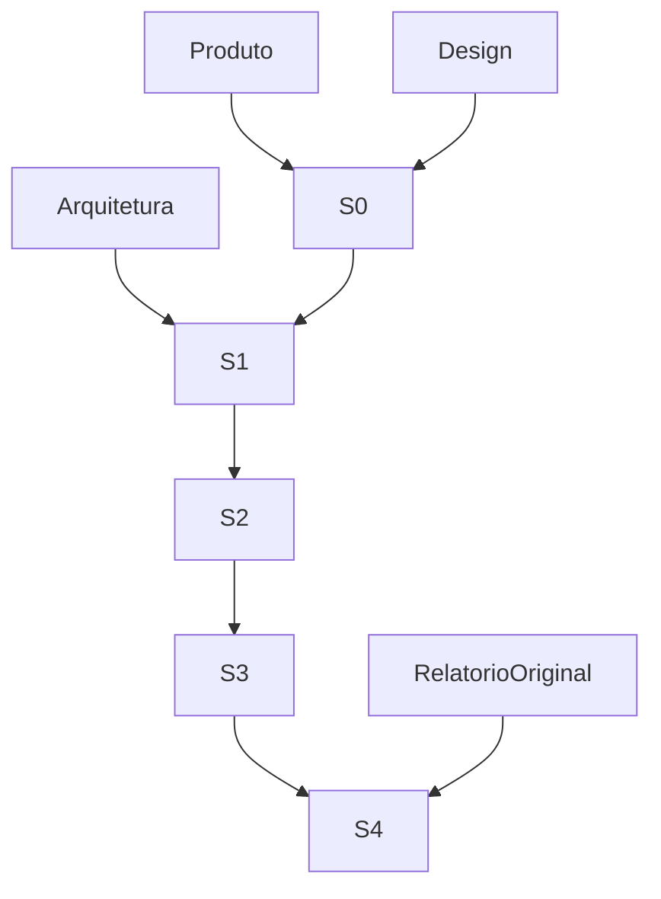

# ClimaOS

Plataforma de gestão de serviços de climatização, inicialmente para a Artcool.

## Entrega inicial

S0: protótipo navegável mobile-first com dados fictícios, usando Next.js, TypeScript, shadcn/ui, Tailwind CSS e Lucide. Fluxo: cliente → equipamento → OS → execução → revisão → relatório.

## Slices verticais

- S0: validar navegação e execução mobile com dados fictícios.
- S1: autenticação, cliente/local/equipamento, OS atribuída, execução textual e PDF simples recuperável.
- S2: checklist, fotos por equipamento, legendas e recuperação de rascunho.
- S3: revisão, assinatura, PDF A4 e versionamento da emissão.
- S4: validar três atendimentos reais contra o relatório de referência.

## Limites

O protótipo não substitui o sistema operacional. Autorização no backend, armazenamento privado, PDF no servidor e auditoria serão implementados nos slices funcionais. Não inserir dados reais no protótipo.
